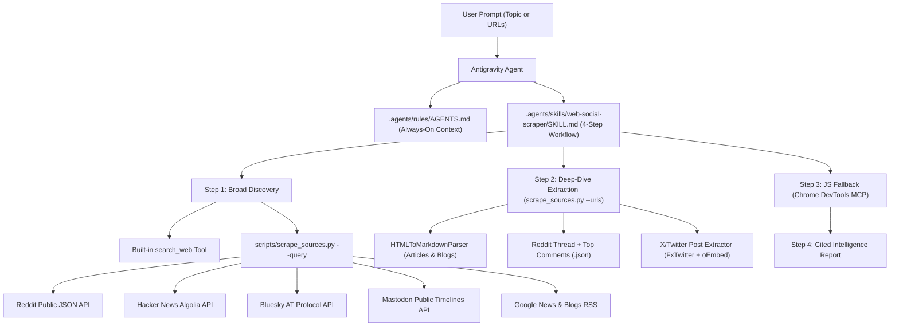

# Web & Social Intelligence Scraper Agent

> **Project Synopsis:** An on-demand AI research agent built for **Google Antigravity** that concurrently scrapes, extracts, and synthesizes articles, blog posts, and real-time community discussions across the open web and social platforms—with **zero external Python dependencies or paid API keys**.

---

## 1. Executive Overview

When researching a technology, product, company, or trend, traditional web search only tells half the story—it surfaces SEO-optimized articles and official press releases while missing grassroots community sentiment. Meanwhile, manually checking Reddit threads, Hacker News discussions, Bluesky, Mastodon, and X (Twitter) is time-consuming and fragmented.

The **Web & Social Intelligence Scraper Agent** solves this by pairing an **Antigravity Custom Skill & Rule Set** with a **concurrent, zero-dependency Python 3 scraping engine** ([`scripts/scrape_sources.py`](scripts/scrape_sources.py)). Given a single topic or list of URLs, the agent:

1. **Discovers & Scrapes Concurrently**: Queries multiple social and news APIs in parallel using a thread pool (`ThreadPoolExecutor`).
2. **Deep-Dives High-Signal Threads & Articles**: Extracts clean Markdown from blog posts/websites and pulls top-ranked comment trees from Reddit discussions or post metadata from X/Twitter.
3. **Synthesizes Editorial vs. Community Sentiment**: Produces a structured, fully cited intelligence briefing that contrasts official/editorial coverage with real user experiences, complaints, and debates.

---

## 2. System Architecture



---

## 3. Data Sources & Scraping Mechanisms

A core design goal of [`scripts/scrape_sources.py`](scripts/scrape_sources.py) is **portability and reliability**: it uses only the Python 3 standard library (`urllib.request`, `concurrent.futures`, `html.parser`, `xml.etree.ElementTree`, `json`) and public, unauthenticated endpoints.

| Platform / Source | Function in `scrape_sources.py` | How It Works Under the Hood | Data Extracted |
| :--- | :--- | :--- | :--- |
| **Reddit Search** | `search_reddit()` | Queries `reddit.com/search.json` with a custom User-Agent header | Post title, subreddit (`r/...`), author, upvote score, comment count, date, self-text snippet, and permalink |
| **Reddit Threads** | `scrape_reddit_thread()` | Appends `.json` to any `/r/.../comments/...` URL | Full original post body + top-ranked comment tree (`author`, `score`, `body`) |
| **Hacker News** | `search_hackernews()` | Queries Algolia's HN Search API (`hn.algolia.com/api/v1/search`) | Story title, points, author, comment count, discussion link, and external URL |
| **Bluesky** | `search_bluesky()` | Queries the public AT Protocol endpoint (`public.api.bsky.app/xrpc/app.bsky.feed.searchPosts`) | Post text, author handle, like count, repost count, reply count, and direct post URL |
| **Mastodon / Fediverse** | `search_mastodon()` | Queries public hashtag timelines (`mastodon.social/api/v1/timelines/tag/...`) and strips HTML tags | Status text, account handle, favorites, boosts, replies, and status URL |
| **Google News & Blogs** | `search_news_rss()` | Fetches and parses XML from `news.google.com/rss/search` | Article headline, publisher name, publication date, summary snippet, and link |
| **X (Twitter) Posts** | `scrape_x_post()` | Queries `api.fxtwitter.com` for status metadata with automatic fallback to `publish.twitter.com/oembed` | Post text, author name/handle, timestamp, likes, retweets, replies, and views |
| **Websites & Blogs** | `scrape_single_url()` + `HTMLToMarkdownParser` | Custom `HTMLParser` subclass that strips noise (`<script>`, `<style>`, `<nav>`, `<footer>`, `<aside>`) and converts headings/lists to Markdown | Page title, meta description (`og:description`), clean article body text, and up to 25 outbound links |

---

## 4. Repository Structure

```text
web-social-scraper/
├── README.md                                        # Project synopsis & architectural documentation
├── scripts/
│   └── scrape_sources.py                            # Zero-dependency multi-platform Python 3 scraper CLI
└── .agents/
    ├── rules/
    │   └── AGENTS.md                                # Workspace rules: synthesis & citation standards
    └── skills/
        └── web-social-scraper/
            └── SKILL.md                             # 4-step progressive disclosure runbook for the agent
```

### How Antigravity Customizations Power the Agent
- **Workspace Rules ([`.agents/rules/AGENTS.md`](.agents/rules/AGENTS.md))**: Automatically loaded when this project is open. Instructs the agent to combine broad search with multi-platform scraping, delegate heavy multi-topic jobs to isolated subagents, and cite every claim or sentiment point with clickable links.
- **On-Demand Skill ([`.agents/skills/web-social-scraper/SKILL.md`](.agents/skills/web-social-scraper/SKILL.md))**: Uses Antigravity's progressive disclosure system to teach the agent the 4-stage workflow:
  1. *Broad Discovery* (`search_web` + `scrape_sources.py --query`)
  2. *Deep-Dive URL & Thread Extraction* (`scrape_sources.py --urls`)
  3. *Browser Fallback* (using `chrome-devtools` MCP for client-side JS or login-gated feeds)
  4. *Actionable Briefing Synthesis* (Executive Summary, Editorial Highlights, Social Pulse & Sentiment)

---

## 5. Usage Guide

### A. Running via the Antigravity Agent (Natural Language)
Open this folder as your active workspace in Antigravity and ask:
- *"Scrape the web and social platforms for what developers are saying about local LLMs on Apple Silicon."*
- *"Research recent blog posts and Reddit/Hacker News discussions on SQLite in production."*
- *"Extract and summarize this Reddit thread and these blog articles: `<url1>` `<url2>`"*

### B. Running the Scraper CLI Directly
You can also run [`scripts/scrape_sources.py`](scripts/scrape_sources.py) standalone from any terminal:

**1. Search a topic across all social & news platforms (outputs Markdown by default):**
```bash
python3 scripts/scrape_sources.py \
  --query "SQLite in production" \
  --platforms reddit hackernews bluesky mastodon news \
  --limit 8 \
  --format markdown
```

**2. Scrape full text and top comments from specific URLs:**
```bash
python3 scripts/scrape_sources.py \
  --urls "https://www.reddit.com/r/programming/comments/..." "https://example.com/blog-post" \
  --format markdown \
  --out report.md
```

**3. Export structured JSON for downstream pipelines:**
```bash
python3 scripts/scrape_sources.py \
  --query "WebAssembly" \
  --format json \
  --out results.json
```
